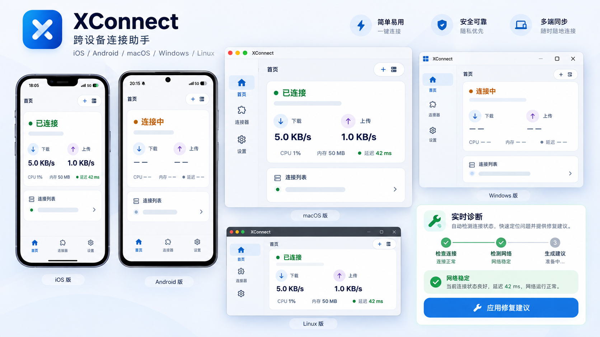

# XConnect

<p align="center">
  
</p>

## Open-source global AI connectivity | 开源全球 AI 连接

XConnect is an open-source, cross-platform connection client for everyday AI and developer tools. It brings connection controls, clear live status, and built-in network diagnostics together across **iOS, Android, macOS, Windows, and Linux**.

XConnect 是一款面向全球用户的开源 AI 连接加速工具，支持 **iOS、Android、macOS、Windows 和 Linux**。连接状态清晰可见；遇到波动时，可查看实时延迟、丢包和网络类型，并按建议检查“本设备 → 路由器 → 节点”链路。

<p align="center">
  
</p>
<p align="center"><sub>Product overview · 产品界面示意；连接状态与网络指标为演示数据。</sub></p>

### What you can do | 主要功能

- **Connect across platforms｜跨平台连接** — Manage Xray/VLESS connection profiles and use the connection mode available on your device. VPN/tunnel behavior and system integration vary by platform.
- **See connection status｜状态实时可见** — Review connection state, latency, and traffic at a glance.
- **Diagnose network issues｜实时网络诊断** — Check latency, packet loss, network type, and each hop in the connection path. Diagnostics use TCP connection probes (not ICMP); results stay on your device.
- **Open source｜开放共建** — Explore the code, report issues, and contribute through GitHub.

### Start in three steps | 三步开始

**Register → Download → Sign in and connect**<br />
**注册 → 下载 → 登录并启动全球 AI 加速**

1. **Register｜注册** — Create an XConnect account from the [product page](https://xworktech.com/products/xconnect).
2. **Download｜下载** — Choose the client for your device from [GitHub Releases](https://github.com/ai-workspace-xstream/xconnect-app/releases).
3. **Sign in and connect｜登录并启动** — Sign in to the client, select a connection, and start. For manual setup, import a compatible VLESS profile.

> Core connection features work without signing in; Sync is optional and does not affect basic connectivity. Core 功能无需登录，Sync 为可选功能，不影响基本连接体验。

See the [XConnect product page](https://xworktech.com/products/xconnect) for the overview and [User Manual](docs/user-manual.md) for setup details. Platform-specific permissions and connection modes may differ.

## TL;DR

```bash
flutter pub get
flutter analyze
flutter test
flutter run -d macos
make build-macos-arm64
```

## Downloads

<!-- SUPPORT_MATRIX:START -->
| 平台 | 架构 | 测试状态 | 下载 |
|------|------|----------|------|
| macOS | arm64 | ✅ 已测试 | [DMG](https://github.com/ai-workspace-xstream/xconnect-app/releases/download/main-191/xconnect-dev-fd6687d.dmg) |
| macOS | x64 | ⚠️ 未测试 | — |
| Linux | x64 | ⚠️ 未测试 | [ZIP](https://github.com/ai-workspace-xstream/xconnect-app/releases/download/main-191/xconnect-linux.zip) / [AppImage](https://github.com/ai-workspace-xstream/xconnect-app/releases/download/main-191/xconnect-linux.AppImage) / [DEB](https://github.com/ai-workspace-xstream/xconnect-app/releases/download/main-191/xconnect-linux-amd64.deb) / [RPM](https://github.com/ai-workspace-xstream/xconnect-app/releases/download/main-191/xconnect-linux-x86_64.rpm) |
| Linux | arm64 | ⚠️ 未测试 | — |
| Windows | x64 | ✅ 已测试 | [ZIP](https://github.com/ai-workspace-xstream/xconnect-app/releases/download/main-191/xconnect-windows.zip) / [MSI](https://github.com/ai-workspace-xstream/xconnect-app/releases/download/main-191/xconnect-windows.msi) |
| Android | arm64 | ⚠️ 未测试 | [APK](https://github.com/ai-workspace-xstream/xconnect-app/releases/download/main-191/app-release.apk) |
| iOS | arm64 | ✅ 已测试 | [IPA](https://github.com/ai-workspace-xstream/xconnect-app/releases/download/main-191/xconnect.ipa) |

> 自动更新：当前下载链接指向 GitHub Release [`main-191`](https://github.com/ai-workspace-xstream/xconnect-app/releases/tag/main-191).
<!-- SUPPORT_MATRIX:END -->

All download buttons currently point to the latest GitHub release page.

## Learn More

- [User Manual](docs/user-manual.md)
- [Developer Guide](docs/dev-guide.md)
- [Architecture Overview](docs/architecture_overview.md)
- [Packet Tunnel Design](docs/packet_tunnel_provider_design.md)
- [macOS Packet Tunnel Implementation](docs/macos-packet-tunnel-implementation.md)
- [iOS Design](docs/ios-design.md)
- [FFI Bridge Architecture](docs/ffi-bridge-architecture.md)
- [MCP Server Guide](docs/xconnect-mcp-server.md)
